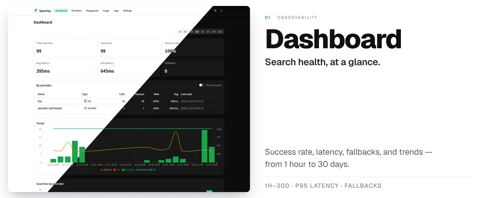
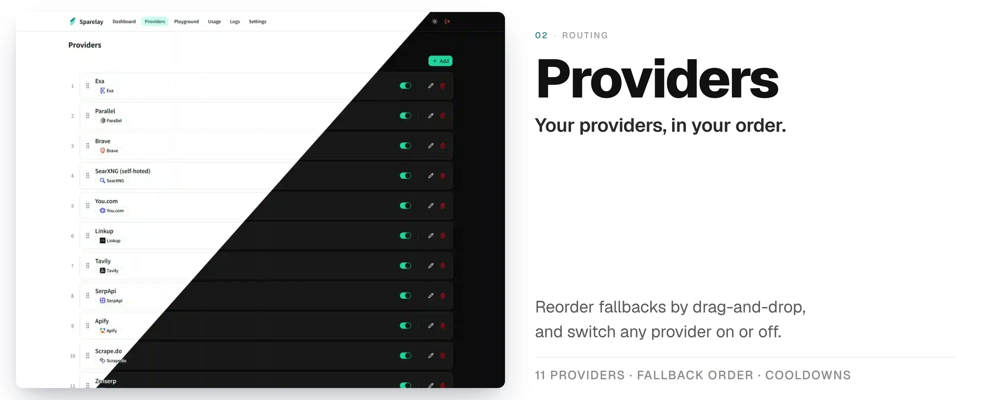
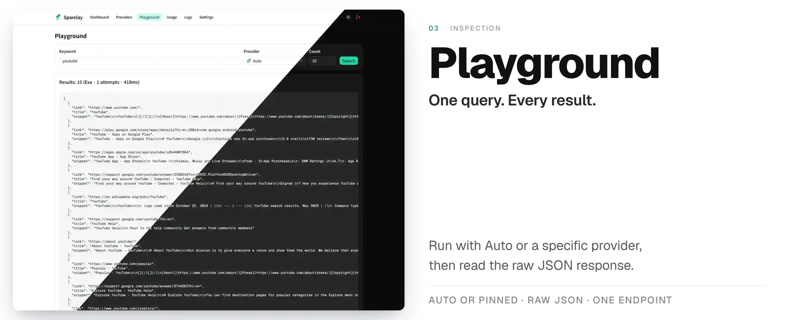
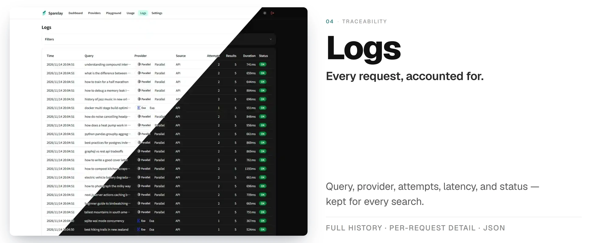

<p align="center">
  <a href="README.md">English</a> · <a href="README.ja.md">日本語</a>
</p>

<p align="center">
  
</p>

<p align="center">
  <a href="https://github.com/sparelay/sparelay/actions/workflows/ci.yml"></a>
  <a href="https://github.com/sparelay/sparelay/releases/latest"></a>
  <a href="https://github.com/sparelay/sparelay/pkgs/container/sparelay"></a>
  <a href="https://openwebui.com"></a>
  <a href="https://modelcontextprotocol.io"></a>
  <a href="LICENSE"></a>
</p>

<h1 align="center">
  Sparelay
</h1>

<p align="center">
  <strong>ひとつの検索API。複数のプロバイダー。自動フォールバック。</strong><br />
  OpenWebUI、LLMエージェント、RAGパイプライン向けのセルフホスト型検索ゲートウェイ。
</p>

<p align="center">
  <a href="#クイックスタート">クイックスタート</a> ·
  <a href="#機能">機能</a> ·
  <a href="#sparelayを選ぶ理由">Sparelayを選ぶ理由</a> ·
  <a href="#インテグレーション">インテグレーション</a> ·
  <a href="#対応プロバイダー">対応プロバイダー</a> ·
  <a href="#設定">設定</a>
</p>









Sparelayはアプリケーションと検索APIの間に立ちます。契約済みのプロバイダーを登録し、好みの順序に並べ、安定した1つのエンドポイントを呼び出すだけです。プロバイダーがエラー、タイムアウト、レート制限、または空の結果を返した場合、Sparelayは自動的に次のプロバイダーを試し、その結果を記録します。

プロバイダー管理、検索プレイグラウンド、利用状況の分析、検索ログ、AIエージェント向けのMCPエンドポイントを備えたWeb UIも同梱しています。

## 機能

- **フォールバック優先のルーティング**。プロバイダーはドラッグ&ドロップで並べた順に試されます。失敗、タイムアウト、空の結果セット（`fallbackOnEmpty`が有効な場合）、`429`応答が発生すると、次のプロバイダーにリクエストを移動します。
- **好きな検索サービスを持ち込める**。Tavily、Brave、Exa、SerpApi、Bright Dataなどの商用APIでも、SearXNGやMwmblなどのセルフホスト型エンジンでも利用できます。
- **すべてを1つのインターフェースで**。OpenWebUI互換のHTTP検索、エージェント向けのMCPツール、ブラウザのプレイグラウンドが同じフォールバックエンジンを共有します。
- **クールダウンを考慮**。`429`を受け取ると、設定した期間そのプロバイダーをクールダウン状態にし、毎回のリクエストで叩き続けることを防ぎます。
- **標準で可観測性を搭載**。総検索数、成功率、平均・P95レイテンシ、フォールバック数、プロバイダー別統計、1時間〜30日のトレンドに加え、クエリ、プロバイダー、試行回数、レイテンシ、ステータス、結果JSONを全件記録する検索ログを備えます。
- **セルフホスト＆単一キー認証**。すべてを自分の環境で実行でき、外部SaaSのコントロールプレーンは不要です。同じ`API_KEY`が管理UIのセッションとBearer認証のAPIを保護します。

## Sparelayを選ぶ理由

プロバイダーAPIを直接呼ぶと、リトライ・順序・レート制限の扱いをクライアントごとに実装することになります。Sparelayはそれを、一度設定すれば済む1つのサービスにまとめます。

|                  | プロバイダーを直接呼ぶ                                  | Sparelay                                                 |
| ---------------- | ------------------------------------------------------- | -------------------------------------------------------- |
| フォールバック   | リトライ、順序、タイムアウトをクライアントごとに実装    | 順序を一度設定すれば、次のプロバイダーが自動で試される   |
| レート制限       | `429`を返したプロバイダーにも各クライアントが叩き続ける | 設定した期間クールダウンし、自動でスキップする           |
| 可観測性         | 失敗や遅延を共有して見る手段がない                      | ダッシュボード、プロバイダー別統計、検索ログを標準搭載   |
| インターフェース | ベンダーごとにリクエスト形式が違う                      | HTTPエンドポイント、MCPツール、プレイグラウンドの3つだけ |

## クイックスタート

1. [Docker](https://docs.docker.com/engine/install/)とDocker Composeをインストールします。

2. `compose.yml`を作成し、以下の内容を記述します：

   ```yaml
   services:
     sparelay:
       image: ghcr.io/sparelay/sparelay:latest
       init: true
       restart: unless-stopped
       ports:
         - "3000:3000"
       environment:
         API_KEY: "${API_KEY:?Set API_KEY in the .env file}"
       volumes:
         - ./data:/app/data
       healthcheck:
         test:
           - CMD
           - bun
           - -e
           - "fetch('http://127.0.0.1:3000/healthz').then((r) => process.exit(r.ok ? 0 : 1)).catch(() => process.exit(1))"
         interval: 30s
         timeout: 5s
         retries: 3
         start_period: 20s
   ```

3. `.env`を作成し、APIキーを設定します：

   ```bash
   echo "API_KEY=$(openssl rand -hex 32)" > .env
   ```

   `API_KEY`は管理UIのセッション暗号化にも使われるため、32文字以上である必要があります。`openssl rand -hex 32`は64文字の値を生成します。

4. スタックを起動します：

   ```bash
   docker compose up -d
   ```

5. [http://localhost:3000](http://localhost:3000)を開き、`API_KEY`の値でログインします。

## インテグレーション

### OpenWebUI

OpenWebUIで<strong>Admin Settings → Web Search</strong>を開き、Web検索を有効にして、エンジンに<strong>External</strong>を選択し、以下を設定します：

- **URL:**`http://your-sparelay-host:3000/search`
- **APIキー:**`API_KEY`と同じ値

Sparelayの<strong>Usage</strong>ページには、現在のデプロイ環境で使える正確なURLとコピー可能なスニペットが表示されます。

### API

#### `POST /search`

設定済みのフォールバックチェーンで検索します。このエンドポイントは、OpenWebUIの外部検索エンジン連携と互換性を持つように設計されています。

**ヘッダー**

```http
Authorization: Bearer YOUR_API_KEY
Content-Type: application/json
```

**ボディ**

| フィールド | 型      | 必須   | 説明                                     |
| ---------- | ------- | ------ | ---------------------------------------- |
| `query`    | string  | はい   | 検索クエリ。前後の空白はトリムされます。 |
| `count`    | integer | いいえ | 最大結果数（1〜50）。デフォルトは `10`。 |

**レスポンス**

すべてのプロバイダーが失敗した場合でも、`200`と結果配列を返します。その場合、配列は空です。認証失敗は`401`、不正なJSONまたは入力は`400`を返します。

#### `GET /healthz`

アプリケーションが稼働中の場合、`{"status":"ok"}`を返します。

### MCP

#### `POST /mcp`

ステートレスな[Model Context Protocol](https://modelcontextprotocol.io/)のStreamable HTTPエンドポイントです。リクエストごとに新しいMCPサーバーとトランスポートが作成されます。

このエンドポイントは`search_web`という名前のツールを1つ公開します：

| 引数    | 型      | 説明                                     |
| ------- | ------- | ---------------------------------------- |
| `query` | string  | 検索クエリ。                             |
| `count` | integer | 最大結果数（1〜50）。デフォルトは `10`。 |

ツールは結果配列をJSONテキストとして返します。

クライアント設定例：

```json
{
  "mcpServers": {
    "sparelay": {
      "url": "http://your-sparelay-host:3000/mcp",
      "headers": {
        "Authorization": "Bearer YOUR_API_KEY"
      }
    }
  }
}
```

## 対応プロバイダー

| プロバイダー | APIキー | デフォルトのベースURL          |
| ------------ | ------- | ------------------------------ |
| SearXNG      | 任意    | 自分のインスタンス             |
| Exa          | 必須    | `https://api.exa.ai`           |
| Tavily       | 必須    | `https://api.tavily.com`       |
| Parallel     | 必須    | `https://api.parallel.ai`      |
| Linkup       | 必須    | `https://api.linkup.so`        |
| You.com      | 必須    | `https://ydc-index.io`         |
| Mwmbl        | 任意    | `https://mwmbl.org`            |
| Brave        | 必須    | `https://api.search.brave.com` |
| Apify        | 必須    | `https://api.apify.com`        |
| SerpApi      | 必須    | `https://serpapi.com`          |
| Zenserp      | 必須    | `https://app.zenserp.com`      |
| Firecrawl    | 任意    | `https://api.firecrawl.dev`    |
| Scrape.do    | 必須    | `https://api.scrape.do`        |
| Bright Data  | 必須    | `https://api.brightdata.com`   |

必要なプロバイダーがない場合はIssueを立ててください。アダプターは小さくまとまった変更で、手順は[CONTRIBUTING.md](CONTRIBUTING.md#adding-a-provider)にあります。

## 設定

### 環境変数

| 変数                    | 必須   | デフォルト               | 説明                                                                                                                                                                                                                 |
| ----------------------- | ------ | ------------------------ | -------------------------------------------------------------------------------------------------------------------------------------------------------------------------------------------------------------------- |
| `API_KEY`               | はい   | —                        | UIログインとすべてのBearer認証API呼び出しを保護します。32文字以上のランダム値を使用してください（例：`openssl rand -hex 32`）。                                                                                      |
| `SESSION_COOKIE_SECURE` | いいえ | 自動                     | セッションCookieの`Secure`属性を明示的に指定します。デフォルトでは`X-Forwarded-Proto`が`https`の場合に有効になります。`true`または`false`で上書きできます。Dockerではサービス`environment`に追加して渡してください。 |
| `DB_PATH`               | いいえ | `./data/database.sqlite` | SQLiteデータベースファイル。Dockerでは `/app/data/database.sqlite` になります。                                                                                                                                      |

`DB_PATH`は、テスト用DBなど別のSQLiteファイルを使いたい場合だけ設定してください。

### アプリケーション設定

- **タイムゾーン** — UIのタイムスタンプ表示に使用。デフォルトは`UTC`。
- **全体タイムアウト** — すべてのプロバイダーを通じた検索の最大合計時間（1〜300秒）。デフォルトは30秒。

## コントリビューション

コントリビューションを歓迎します。まず[CONTRIBUTING.md](CONTRIBUTING.md)と[CODE_OF_CONDUCT.md](CODE_OF_CONDUCT.md)をお読みください。変更は焦点を絞り、動作変更にはテストを追加してください。

```bash
bun install
bun run typecheck && bun run lint && bun run test
```

プロバイダーの追加は小さくまとまった変更です。手順は[Adding a provider](CONTRIBUTING.md#adding-a-provider)を参照してください。セキュリティ問題は公開Issueではなく[SECURITY.md](SECURITY.md)へお願いします。

## コミュニティ

- [コントリビューション](CONTRIBUTING.md)
- [行動規範](CODE_OF_CONDUCT.md)
- [セキュリティ](SECURITY.md)
- [ガバナンス](GOVERNANCE.md)
- [メンテナー](MAINTAINERS.md)
- [サポート](SUPPORT.md)
- [変更履歴](CHANGELOG.md)

## ライセンス

[MIT License](LICENSE)

---

Sparelayが検索の手間やコストを減らせたら、⭐で他の人にも届けてください。
