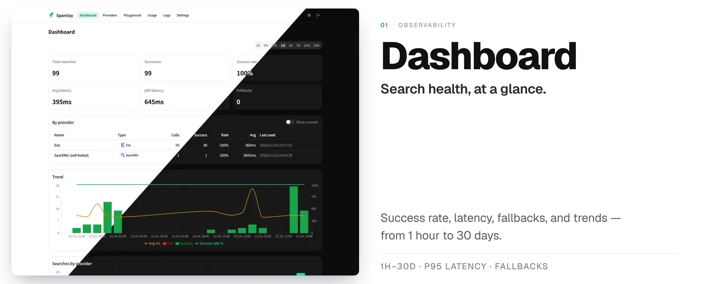
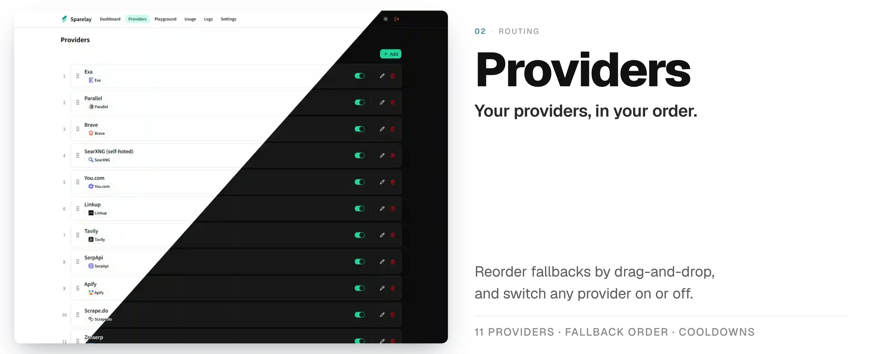
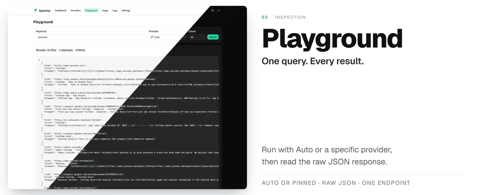
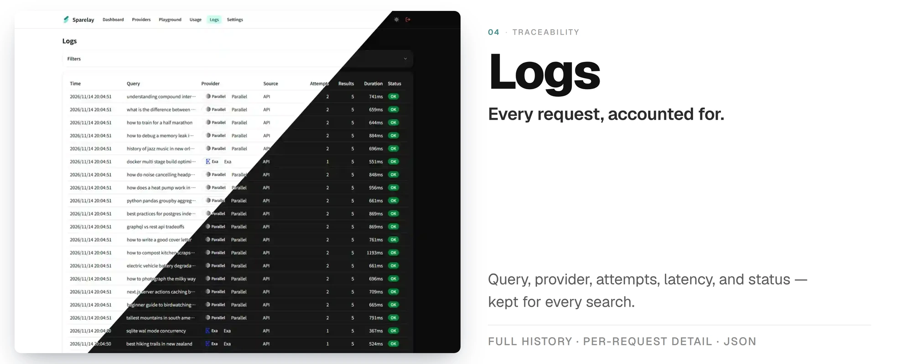
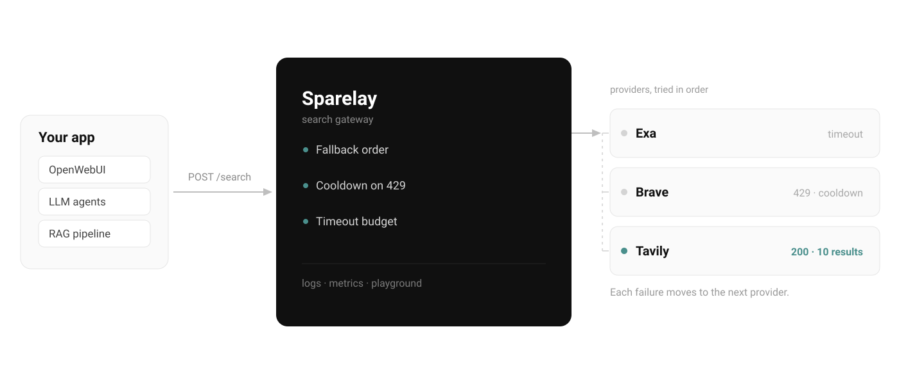

<p align="center">
  <a href="README.md">English</a> · <a href="README.ja.md">日本語</a>
</p>

<p align="center">
  
</p>

<p align="center">
  <a href="https://github.com/sparelay/sparelay/actions/workflows/ci.yml"></a>
  <a href="https://github.com/sparelay/sparelay/releases/latest"></a>
  <a href="https://github.com/sparelay/sparelay/pkgs/container/sparelay"></a>
  <a href="https://openwebui.com"></a>
  <a href="https://modelcontextprotocol.io"></a>
  <a href="LICENSE"></a>
</p>

<h1 align="center">
  Sparelay
</h1>

<p align="center">
  <strong>A self-hosted search gateway for OpenWebUI, LLM agents, and RAG pipelines.</strong>
</p>

<p align="center">
  <a href="#quick-start">Quick Start</a> ·
  <a href="#features">Features</a> ·
  <a href="#why-sparelay">Why Sparelay</a> ·
  <a href="#how-it-works">How It Works</a> ·
  <a href="#integrations">Integrations</a> ·
  <a href="#supported-providers">Supported Providers</a> ·
  <a href="#configuration">Configuration</a>
</p>









Sparelay sits between your application and search APIs. Register the providers you already pay for, put them in the order you prefer, and call one stable endpoint. If a provider errors, times out, is rate-limited, or returns nothing, Sparelay tries the next one automatically and records what happened.

It ships with a web UI for provider management, a search playground, usage analytics, search logs, and an MCP endpoint for AI agents.

## Features

- **Fallback-first routing.** Providers are tried in a drag-and-drop order. Failures, timeouts, empty result sets, and `429` responses move the request to the next provider.
- **Bring your own search.** Use commercial APIs such as Tavily, Brave, Exa, SerpApi, and Bright Data, or self-hosted engines such as SearXNG and Mwmbl.
- **One interface for everything.** OpenWebUI-compatible HTTP search, an MCP tool for agents, and a browser playground share the same fallback engine.
- **Cooldown awareness.** A `429` puts that provider on cooldown for a configurable window instead of hammering it on every request.
- **Observability built in.** Totals, success rate, average and P95 latency, fallbacks, per-provider stats, and trends from 1 hour to 30 days — plus a search log with the query, provider, attempts, latency, status, and raw result JSON for every request.
- **Self-hosted and single-key.** Everything runs in your own environment with no external SaaS control plane, and the same `API_KEY` protects the admin UI session and the Bearer-authenticated API.

## Why Sparelay

Calling provider APIs directly means building retries, ordering, and rate-limit handling into every client. Sparelay moves that into one service you configure once.

|               | Calling providers directly                                | Sparelay                                                     |
| ------------- | --------------------------------------------------------- | ------------------------------------------------------------ |
| Fallback      | Implement retries, ordering, and timeouts per client      | Set the order once; the next provider is tried automatically |
| Rate limits   | Every client keeps hitting a provider that returned `429` | The provider is put on cooldown for a configurable window    |
| Observability | No shared view of failures or latency                     | Dashboard, per-provider stats, and search logs built in      |
| Interfaces    | A different request shape per vendor                      | One HTTP endpoint, one MCP tool, one playground              |

## Quick Start

1. [Install Docker](https://docs.docker.com/engine/install/) and Docker Compose.

2. Create `compose.yml` with the following content:

   ```yaml
   services:
     sparelay:
       image: ghcr.io/sparelay/sparelay:latest
       init: true
       restart: unless-stopped
       ports:
         - "3000:3000"
       environment:
         API_KEY: "${API_KEY:?Set API_KEY in the .env file}"
       volumes:
         - ./data:/app/data
       healthcheck:
         test:
           - CMD
           - bun
           - -e
           - "fetch('http://127.0.0.1:3000/healthz').then((r) => process.exit(r.ok ? 0 : 1)).catch(() => process.exit(1))"
         interval: 30s
         timeout: 5s
         retries: 3
         start_period: 20s
   ```

3. Create `.env` and set your API key:

   ```bash
   echo "API_KEY=$(openssl rand -hex 32)" > .env
   ```

   `API_KEY` must be at least 32 characters because it is also used to encrypt the admin session. `openssl rand -hex 32` produces a 64-character value.

4. Start the stack:

   ```bash
   docker compose up -d
   ```

5. Open [http://localhost:3000](http://localhost:3000) and sign in with the `API_KEY` value.

## How It Works

A search request takes the same path no matter which interface called it.



1. **Filter providers.** Only enabled providers are considered, ordered by their saved position.
2. **Skip cooling providers.** A provider whose `cooldownUntil` is in the future is skipped.
3. **Apply time budgets.** Each provider gets a bounded slice of the overall timeout, which comes from **Settings** and defaults to 30 seconds.
4. **Call the provider.** Providers normalize their native response into `{ link, title, snippet }`.
5. **Fall back when needed.** Errors, timeouts, and empty responses (when `fallbackOnEmpty` is enabled) cause the next provider to be tried.
6. **Record the outcome.** The request is logged with attempts, latency, status, and source (`api`, `mcp`, or `playground`).

For the exact timeout math, cooldown windows, and log fields, see [How it works in depth](docs/how-it-works.md).

## Integrations

### OpenWebUI

In OpenWebUI, open **Admin Settings → Web Search**, enable web search, select **External** as the engine, and set:

- **URL:** `http://your-sparelay-host:3000/search`
- **API key:** the same value as `API_KEY`

The **Usage** page in Sparelay shows the exact URLs and copy-ready snippets for the current deployment.

### API

#### `POST /search`

Search through the configured fallback chain. This endpoint is intentionally compatible with OpenWebUI's external search engine integration.

**Headers**

```http
Authorization: Bearer YOUR_API_KEY
Content-Type: application/json
```

**Body**

| Field   | Type    | Required | Description                                               |
| ------- | ------- | -------- | --------------------------------------------------------- |
| `query` | string  | Yes      | Search query. Leading and trailing whitespace is trimmed. |
| `count` | integer | No       | Maximum results, from 1 to 50. Defaults to `10`.          |

**Response**

Returns `200` with an array of results, even when every provider fails. In that case the array is empty. Authentication failures return `401`; malformed JSON or invalid input returns `400`.

#### `GET /healthz`

Returns `{"status":"ok"}` when the application is running.

### MCP

#### `POST /mcp`

A stateless [Model Context Protocol](https://modelcontextprotocol.io/) Streamable HTTP endpoint. A fresh MCP server and transport are created for every request.

The endpoint exposes one tool named `search_web`:

| Argument | Type    | Description                                      |
| -------- | ------- | ------------------------------------------------ |
| `query`  | string  | Search query.                                    |
| `count`  | integer | Maximum results, from 1 to 50. Defaults to `10`. |

The tool returns the result array as JSON text.

Example client configuration:

```json
{
  "mcpServers": {
    "sparelay": {
      "url": "http://your-sparelay-host:3000/mcp",
      "headers": {
        "Authorization": "Bearer YOUR_API_KEY"
      }
    }
  }
}
```

## Supported Providers

| Provider    | API key  | Default base URL               |
| ----------- | -------- | ------------------------------ |
| SearXNG     | Optional | Your own instance              |
| Exa         | Required | `https://api.exa.ai`           |
| Tavily      | Required | `https://api.tavily.com`       |
| Parallel    | Required | `https://api.parallel.ai`      |
| Linkup      | Required | `https://api.linkup.so`        |
| You.com     | Required | `https://ydc-index.io`         |
| Mwmbl       | Optional | `https://mwmbl.org`            |
| Brave       | Required | `https://api.search.brave.com` |
| Apify       | Required | `https://api.apify.com`        |
| SerpApi     | Required | `https://serpapi.com`          |
| Zenserp     | Required | `https://app.zenserp.com`      |
| Firecrawl   | Optional | `https://api.firecrawl.dev`    |
| Scrape.do   | Required | `https://api.scrape.do`        |
| Bright Data | Required | `https://api.brightdata.com`   |

Missing a provider you need? Open an issue — adapters are a small, well-defined change, and the steps are in [CONTRIBUTING.md](CONTRIBUTING.md#adding-a-provider).

## Configuration

### Environment Variables

| Variable                | Required | Default                  | Description                                                                                                                                                                                                         |
| ----------------------- | -------- | ------------------------ | ------------------------------------------------------------------------------------------------------------------------------------------------------------------------------------------------------------------- |
| `API_KEY`               | Yes      | —                        | Protects UI login and every Bearer-authenticated API call. Use a random value of at least 32 characters (for example, `openssl rand -hex 32`).                                                                      |
| `SESSION_COOKIE_SECURE` | No       | auto                     | Forces the session cookie's `Secure` attribute. By default it is enabled when `X-Forwarded-Proto` is `https`. Set `true` or `false` to override. In Docker, add it to the service `environment` to pass it through. |
| `DB_PATH`               | No       | `./data/database.sqlite` | SQLite database file. In Docker this resolves to `/app/data/database.sqlite`.                                                                                                                                       |

`DB_PATH` is only needed when you want to use a different SQLite file, such as a separate test database.

### Application Settings

- **Timezone** — used to format timestamps in the UI. Defaults to `UTC`.
- **Overall timeout** — maximum total time for a search across all providers, from 1 to 300 seconds. Defaults to 30 seconds.

## Contributing

Contributions are welcome. Read [CONTRIBUTING.md](CONTRIBUTING.md) and [CODE_OF_CONDUCT.md](CODE_OF_CONDUCT.md) first, keep changes focused, and add tests for behavior changes.

```bash
bun install
bun run typecheck && bun run lint && bun run test
```

New providers are a small, well-defined change — see [Adding a provider](CONTRIBUTING.md#adding-a-provider). For security issues, use [SECURITY.md](SECURITY.md) instead of a public issue.

## Community

- [Contributing](CONTRIBUTING.md) · [Code of Conduct](CODE_OF_CONDUCT.md) · [Security](SECURITY.md)
- [Governance](GOVERNANCE.md) · [Maintainers](MAINTAINERS.md) · [Support](SUPPORT.md) · [Changelog](CHANGELOG.md)

## License

[MIT License](LICENSE)

---

If Sparelay saves you a search bill, a ⭐ helps other people find it.
